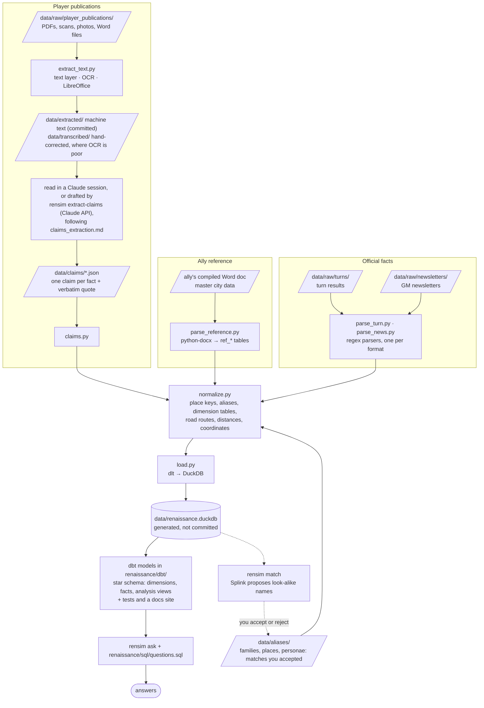
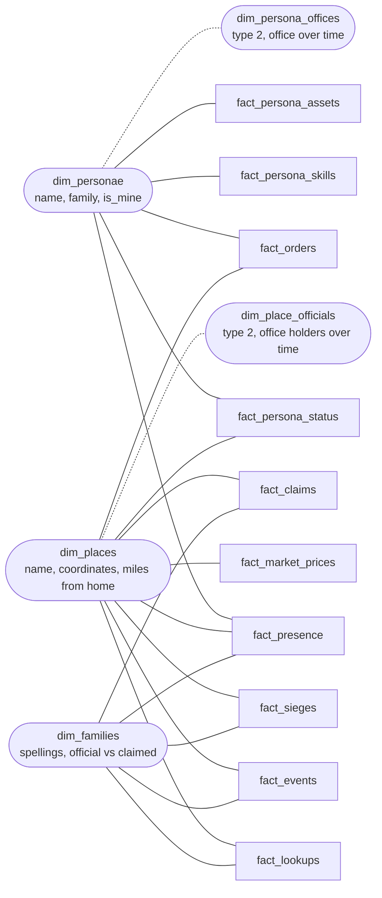

# Architecture

What the pieces are, how data moves through them, and why it's built this way.
For running it and the table list, see the [README](../README.md).

## The shape: a small ELT pipeline

Slanted boxes are files, rectangles are code, the cylinder is the database.

`rensim run` runs everything top to bottom, ending with `dbt run` (build the views) and
`dbt test`. `rensim ask` only reads. `rensim match` (dotted) reads the database and proposes
aliases; only the ones you accept reach the next run.

## Components

| Piece | Responsibility | Notes |
|---|---|---|
| `renaissance/common.py` | Shared helpers | Reads the DOS-era files (cp1252, CRLF, Ctrl-Z padding); dates; `,349,402`-style numbers; degrees.minutes coordinates; place keys |
| `renaissance/parse_turn.py` | Turn report -> rows | Splits the report at `*****` lines: personae block, one block per location, then lookup answers. Drops the billing/address block |
| `renaissance/add.py`, `renaissance/fetch.py` | New files -> `data/raw/` | `rensim add` checks a file with its parser, names it from what's inside and removes the mailing address; `rensim fetch` does the same for attachments in mail from the GM (IMAP, read-only, only mail the GM's domain signed) |
| `renaissance/parse_news.py` | GM newsletter -> rows | Sections by ALL-CAPS heading; events matched against templates sentence by sentence; anything unmatched kept as `other` |
| `renaissance/extract_text.py` | Publication -> text | Run by hand when a new publication arrives (needs Tesseract + LibreOffice); output is committed so CI doesn't need them |
| `renaissance/parse_reference.py` | Ally reference -> `ref_*` tables | Reads an ally's compiled Word document of GM data (python-docx): cities and characters, each city with its own as-of date |
| `renaissance/claims.py` | Claims files -> rows | Validates each file and checks every quote is really in the source text |
| `renaissance/normalize.py` | Make sources joinable | `*_key` columns for places and families, persona IDs for characters named without one (all through `data/aliases/`); `dim_places`, `dim_personae`, `dim_families` |
| `renaissance/match.py` | Propose aliases | `rensim match`: Splink scores look-alike family, place and character names; you mark each proposal y or n; `--apply` writes the accepted ones to `data/aliases/`. Optional extra: `pip install "rensim-tools[match]"` |
| `renaissance/load.py` | Rows -> database | dlt into DuckDB, with explicit column types |
| `renaissance/dbt/` | Meaning on top of rows | A dbt project, one model (a `SELECT`) per view. Star schema: dimensions, facts, then analysis views where snapshots become "now" and "what changed" and claims sit beside official facts. YAML beside the models holds descriptions and tests |
| `renaissance/dbt_runner.py` | Runs dbt | `rensim dbt ...`: any dbt command, pointed at your database, in its own process; working files in `.dbt/` |
| `renaissance/sql/questions.sql`, `ask.py` | Answers | Saved questions plus ad hoc SQL |
| `tests/` | Trust | Run against a made-up account in `tests/fixtures/`, so no real game files are needed; keep tests against your own files in your data repo |
| `.github/workflows/test.yml` | CI | Every push: tests, every command on the fixtures, `dbt build`, the dbt docs site as a download |

## Data model

The dbt models are a star schema in three layers, one folder each under `renaissance/dbt/models/`. **Dimensions** hold the descriptive attributes you
filter and label by: who, where, when, which source. **Facts** hold one row per measurement or
event, as keys into the dimensions plus measures. **Analysis views** (`v_*`) answer the everyday
questions from facts and dimensions. Every fact shares the same (conformed) dimensions, so
prices, events and orders for one place or one month line up without matching spellings. The
saved questions use the facts, dimensions and analysis views; the loaded tables stay available
for ad hoc SQL.

Rounded boxes are dimensions and square boxes are facts. Facts never join to other facts. Not
drawn, because every fact has them: `turn_month` into `dim_turns` (one row per game month) and
`source_id` into `dim_sources` (kind and reliability of each document). Dotted lines link a
dimension to its history.

| Fact | Type | Grain: one row per... | Built from |
|---|---|---|---|
| `fact_persona_status` | periodic snapshot | persona × turn report | `turn_persona_status` |
| `fact_persona_skills` | periodic snapshot | persona × skill × turn report | `turn_persona_skills` |
| `fact_persona_assets` | periodic snapshot | persona × asset × turn report | `turn_persona_assets` |
| `fact_presence` | periodic snapshot | persona seen × place × inside/outside × turn report | `turn_presence` |
| `fact_market_prices` | periodic snapshot | place × side × item × source (× claim) | `turn_market`, `ref_city_market`, `claim_market` |
| `fact_lookups` | transaction | lookup answered in a turn report | `turn_lookups` |
| `fact_events` | transaction | newsletter event | `news_events` |
| `fact_sieges` | transaction | siege reported in a newsletter, with its result | `news_sieges`, `news_siege_results` |
| `fact_orders` | transaction | order code sent | `orders_sent` |
| `fact_claims` | transaction | claim in a publication | `claims` |

The dbt tests (in the YAML beside the models) check every fact is unique at its grain
(`unique_grain`, a test in `renaissance/dbt/tests/generic/`), every key finds its dimension row
(`relationships`), and categories such as `reliability` and `hedge` hold known values
(`accepted_values`), so a parser change that breaks the model fails a test. `rensim run` runs them
after every load, and `tests/test_star.py` runs them on the fixtures; it also checks the type 2
history on made-up scenarios, which reads better in Python.

**Snapshot measures don't add up across turns.** Morale restated every turn is compared or read
at a point in time, never summed; transaction rows can be counted.

**`dim_turns` is keyed on the game month** (`1547-01`), because turn reports carry an end-of-month
date, orders a month and claims a publication date. `month_index` counts months, so the calendar
month before is `month_index - 1`; the previous turn *report* can be further back (`v_turns`).

**Names live in dimensions, except where there's no key.** A persona's name comes from
`dim_personae` and a place's from `dim_places`. Newsletter actors and claim subjects have no game
ID, so their names stay on the fact, and so does a lookup's place, since a failed lookup names no
real place.

**Offices are slowly changing (type 2).** `dim_personae` keeps the latest values (type 1);
`dim_persona_offices` keeps one row per version of a persona's office, and
`dim_place_officials` one per holder of each office at a place, each with `valid_from` /
`valid_to` (exclusive, NULL while current). A fact joins to the version in force at its month:
`f.turn_month >= o.valid_from AND (f.turn_month < o.valid_to OR o.valid_to IS NULL)`, so an
order shows the office its sender held that month.

## Design decisions

**Raw files are the source of truth; the database is disposable.**
Every run rebuilds the database from `data/raw/` (dlt's `replace` mode). A parser fix applies to
every past turn at once, and there's no migration to manage. The database file is gitignored.

**Each turn is a snapshot.** Turn tables hold one row per fact per turn (`game_date`, `source_id`).
"Current" and "changed since last turn" are views over the snapshots, not separate tables. Every
row also carries `account` and `player_family`, because one account can play different families
over time and allies' shared reports load alongside.

**Three levels of trust.** Your turn results and the GM's newsletter are `official`. An ally's
compiled transcription of GM reports (master city data) is `ally_compiled`: same origin,
but second-hand and dated per city. Player publications are `player_claim`. Where sources
overlap, the more trustworthy and fresher one wins (coordinates, `v_markets`).

**Official facts and player claims never mix.** Turn results and the GM's newsletter are facts as
of their date. Player publications are propaganda, so each statement becomes a claim with a hedge
(`asserted` / `reported` / `rumored` / `denied`, from the source's own wording), who made it, and
the exact words. Claims live in their own tables; views put them next to the official record.

**Claims can't say more than the page.** Every claim stores a verbatim quote, and a test fails if
the quote isn't in the source text. That's the guard against an AI (or a person) inventing detail.
OCR drafts and corrected transcriptions are both kept so corrections can be reviewed.

**Messy names are resolved in one place.** Spelling drift (`PEGU`/`Pegu`, `pNompenh`) gets a
normalized key; variants a key can't catch go in `data/aliases/` (`families.csv`, `places.csv`,
and `personae.csv` for characters named without their game ID). Characters are keyed by their
game ID, never by name.

**Look-alike names are proposed, never merged.** Habsburg, HABSBOURG and HAPSBOURG all hold
separate towers in the same city, so they stay three families. `rensim match` uses
[Splink](https://moj-analytical-services.github.io/splink/) to score pairs of names (spelling,
places in common, distance apart) and writes the likely ones to `data/aliases/proposed.csv`; an
alias exists only once you accept it. One rule overrides the score: the GM doesn't misspell, so
two different names that both appear in turn reports or GM newsletters are never proposed. The
model's settings are set by hand (with u measured from your names) because a game has hundreds of
names, not the many thousands Splink's training needs; precision is measured on a labelled sample
in the tests, and on your own with `rensim match --score`.

**Nothing is silently dropped.** Lines no pattern matches go to `unparsed_lines`; newsletter
events that match no template are kept as `other` with their full text. `rensim run` prints both.

**Private data stays out.** The parser never reads past the billing/address block, and turn
reports shared by other players are committed with that block removed. Saved webmail pages
aren't committed as-is.

**Plain tools, one database.** Python, regex, SQL. dlt loads DuckDB, and dbt builds the views on
it. dbt earns its place once the views are a model rather than a script: each view is its own
file, `ref()` gives the build order, tests sit beside the SQL they check, and the docs site is
generated from the same descriptions. An earlier version also ran on SQLite and compared the two
engines' answers; dbt's SQLite support is thin, so DuckDB is the only database now.

**Every model is a view.** Views store a query, not rows, so the database holds only the loaded
tables and an answer can never be stale. The data is small enough that recomputing is instant.

**Models build, then tests run.** `rensim run` runs `dbt run` and then `dbt test`, not `dbt build`,
which would skip every view downstream of a failing test. A bad row is reported without taking the
views away; CI runs `dbt build`, where stopping is the point.

## Adding things

| To add | Do this |
|---|---|
| A new turn or GM newsletter | `rensim fetch --run` with `[fetch]` set up, or `rensim add FILE --run` (or save it under `data/raw/` yourself and `rensim run`) |
| A new turn-report line type | Add a branch in `parse_location` / `parse_personae`, plus a test with the real line |
| A new newsletter event type | Add a template to `EVENT_TEMPLATES` in `parse_news.py`; count it against the raw text in a test |
| A player publication | Raw file -> `rensim extract` -> claims file by hand or `rensim extract-claims` (see `renaissance/claims_extraction.md`) |
| A spelling alias | `rensim match`, mark the proposal y, `rensim match --apply`; or add a row to a `data/aliases/` file by hand |
| A question | A `-- name:` block in `renaissance/sql/questions.sql` |
| A view | A model in `renaissance/dbt/models/<layer>/`, with its description and tests in that folder's `.yml` |

## Where it's headed

- **A review page for `rensim match`** in place of editing `proposed.csv`.
- **An MCP server** over the database, so questions can be asked in plain English.
