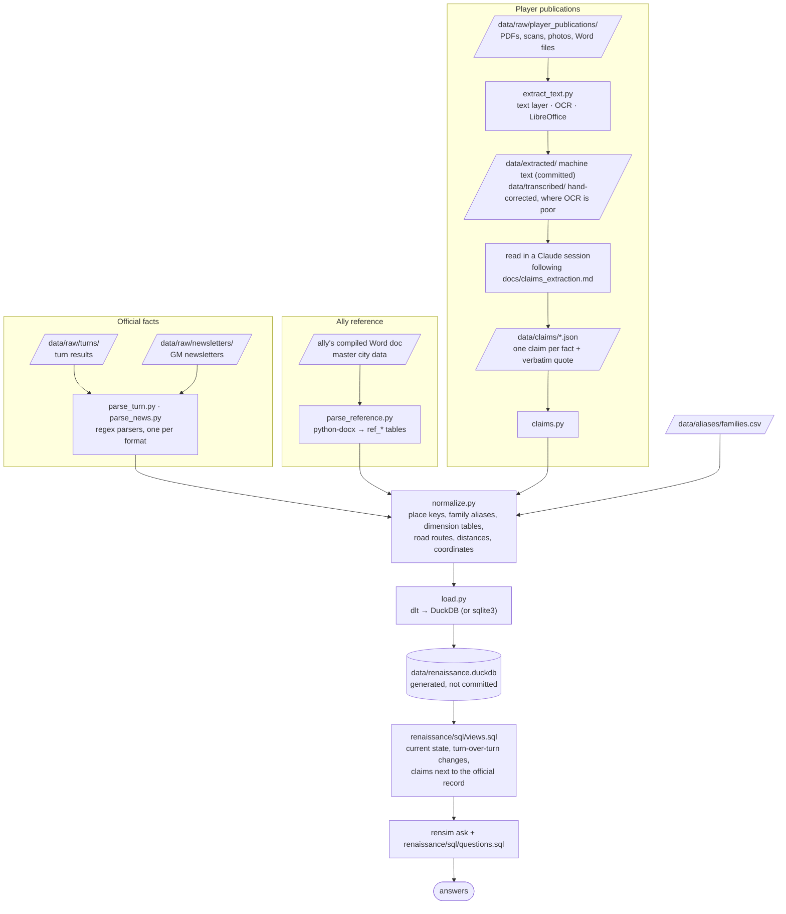
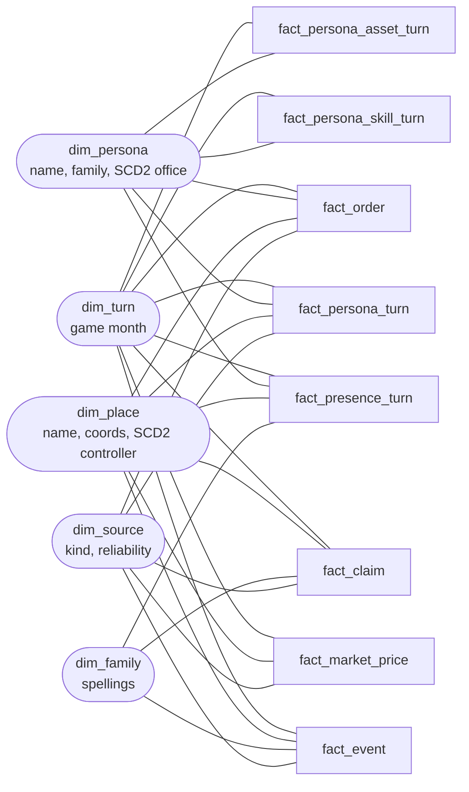

# Architecture

What the pieces are, how data moves through them, and why it's built this way.
For running it and the table list, see the [README](../README.md).

## The shape: a small ELT pipeline

Slanted boxes are files, rectangles are code, the cylinder is the database.

`rensim run` runs everything top to bottom. `rensim ask` only reads.

## Components

| Piece | Responsibility | Notes |
|---|---|---|
| `renaissance/common.py` | Shared helpers | Reads the DOS-era files (cp1252, CRLF, Ctrl-Z padding); dates; `,349,402`-style numbers; degrees.minutes coordinates; place keys |
| `renaissance/parse_turn.py` | Turn report -> rows | Splits the report at `*****` lines: personae block, one block per location, then lookup answers. Drops the billing/address block |
| `renaissance/parse_news.py` | GM newsletter -> rows | Sections by ALL-CAPS heading; events matched against templates sentence by sentence; anything unmatched kept as `other` |
| `renaissance/extract_text.py` | Publication -> text | Run by hand when a new publication arrives (needs Tesseract + LibreOffice); output is committed so CI doesn't need them |
| `renaissance/parse_reference.py` | Ally reference -> `ref_*` tables | Reads an ally's compiled Word document of GM data (python-docx): cities and characters, each city with its own as-of date |
| `renaissance/claims.py` | Claims files -> rows | Validates each file and checks every quote is really in the source text |
| `renaissance/normalize.py` | Make sources joinable | `*_key` columns for places and families; `dim_places`, `dim_personae`, `dim_families` |
| `renaissance/load.py` | Rows -> database | dlt into DuckDB, with explicit column types; sqlite3 fallback with the same tables |
| `renaissance/sql/views.sql` | Meaning on top of rows | Snapshots become "now" and "what changed"; claims sit beside official facts |
| `renaissance/sql/questions.sql`, `ask.py` | Answers | Saved questions plus ad hoc SQL |
| `tests/` | Trust | Run against a made-up account in `tests/fixtures/`, so no real game files are needed; keep tests against your own files in your data repo |
| `.github/workflows/check.yml` | CI | Every push: tests, full load, all questions; answers on the run's summary page |

## Data model

A star schema: fact tables hold keys and measures, and dimensions hold the descriptive
attributes you filter and label by. Every fact shares the same (conformed) dimensions, so
prices, events and orders for one place or one month line up without matching spellings.

> Planned in issue #2: `views.sql` doesn't use these names yet.

Rounded boxes are dimensions and square boxes are facts. Facts never join to other facts.

| Fact | Type | Grain: one row per... | Built from |
|---|---|---|---|
| `fact_persona_turn` | periodic snapshot | persona × turn | `turn_persona_status` |
| `fact_persona_skill_turn` | periodic snapshot | persona × skill × turn | `turn_persona_skills` |
| `fact_persona_asset_turn` | periodic snapshot | persona × asset × turn | `turn_persona_assets` |
| `fact_presence_turn` | periodic snapshot | persona seen × place × inside/outside × turn | `turn_presence` |
| `fact_market_price` | periodic snapshot | place × side × item × source | `turn_market`, `ref_city_market`, `claim_market` |
| `fact_event` | transaction | newsletter event | `news_events` |
| `fact_order` | transaction | order code sent | `orders_sent` |
| `fact_claim` | transaction | claim in a publication | `claims` |

**Snapshot measures don't add up across turns.** Morale restated every turn is compared or read
at a point in time, never summed; transaction rows can be counted.

**`dim_turn` is keyed on the game month** (`1547-01`), because turn reports carry an end-of-month
date, orders a month and claims a publication date. It also gives each turn its previous turn.

**Office and control are slowly changing (type 2).** `dim_persona` keeps one row per version of a
persona's office, and `dim_place` one per change of controller (from `turn_location_officials`),
each with `valid_from` / `valid_to`. A fact joins to the version valid at its turn, so a February
order shows the office its sender held in February.

## Design decisions

**Raw files are the source of truth; the database is disposable.**
Every run rebuilds the database from `data/raw/` (dlt's `replace` mode). A parser fix applies to
every past turn at once, and there's no migration to manage. The database file is gitignored.

**Each turn is a snapshot.** Turn tables hold one row per fact per turn (`game_date`, `source_id`).
"Current" and "changed since last turn" are views over the snapshots, not separate tables. Every
row also carries `account` and `player_family`, because one account can play different families
over time and allies' shared reports load alongside.

**Three levels of trust.** Your turn results and the GM's newsletter are `official`. An ally's
compiled transcription of GM reports (master city data) is `ally_compiled`: same origin,
but second-hand and dated per city. Player publications are `player_claim`. Where sources
overlap, the more trustworthy and fresher one wins (coordinates, `v_markets`).

**Official facts and player claims never mix.** Turn results and the GM's newsletter are facts as
of their date. Player publications are propaganda, so each statement becomes a claim with a hedge
(`asserted` / `reported` / `rumored` / `denied`, from the source's own wording), who made it, and
the exact words. Claims live in their own tables; views put them next to the official record.

**Claims can't say more than the page.** Every claim stores a verbatim quote, and a test fails if
the quote isn't in the source text. That's the guard against an AI (or a person) inventing detail.
OCR drafts and corrected transcriptions are both kept so corrections can be reviewed.

**Messy names are resolved in one place.** Spelling drift (`PEGU`/`Pegu`, `pNompenh`) gets a
normalized key; confirmed variants that a key can't catch go in `data/aliases/families.csv`.
Near-identical names aren't merged on looks alone: Habsburg, HABSBOURG and HAPSBOURG all hold
separate towers in the same city, so they stay three families. Characters are keyed by their game ID, never by name.

**Nothing is silently dropped.** Lines no pattern matches go to `unparsed_lines`; newsletter
events that match no template are kept as `other` with their full text. `rensim run` prints both.

**Private data stays out.** The parser never reads past the billing/address block, and turn
reports shared by other players are committed with that block removed. Saved webmail pages
aren't committed as-is.

**Plain tools, two backends.** Python, regex, SQL. DuckDB (via dlt) is the main database;
the same tables and SQL also run on Python's built-in sqlite3. Comparing the two backends'
answers (`rensim compare`, run in CI) catches SQL dialect differences.

## Adding things

| To add | Do this |
|---|---|
| A new turn or GM newsletter | Drop the file in `data/raw/turns/` or `data/raw/newsletters/`, run `rensim run` |
| A new turn-report line type | Add a branch in `parse_location` / `parse_personae`, plus a test with the real line |
| A new newsletter event type | Add a template to `EVENT_TEMPLATES` in `parse_news.py`; count it against the raw text in a test |
| A player publication | Raw file -> `rensim extract` -> claims file (see `docs/claims_extraction.md`) |
| A spelling alias | A row in `data/aliases/families.csv` |
| A question | A `-- name:` block in `renaissance/sql/questions.sql` |

## Where it's headed

- **Automatic claim extraction**: run `docs/claims_extraction.md` through the Claude API when a
  publication lands; the quote check stays the safety net.
- **Entity resolution** with Splink once there are enough names to need it.
- **dbt** in place of `views.sql` when the model outgrows one file.
- **An MCP server** over the database, so questions can be asked in plain English.
