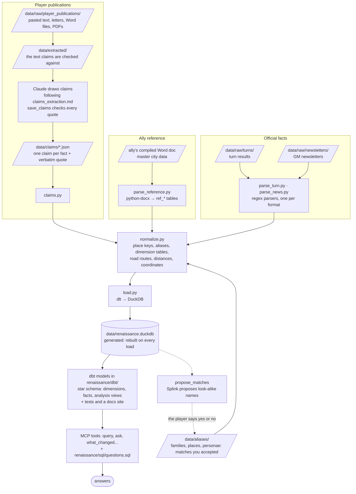
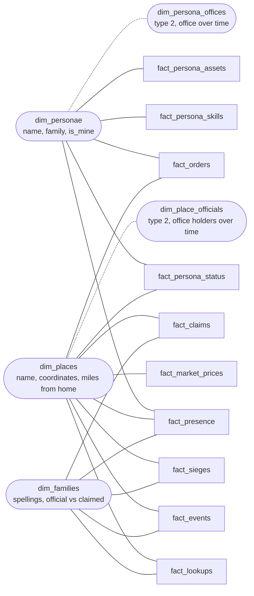

# Architecture

What the pieces are, how data moves through them, and why it's built this way.
For installing it, see the [README](../README.md); for working on it, [development](development.md).

## The shape: a small ELT pipeline

Slanted boxes are files, rectangles are code, the cylinder is the database.

Everything runs inside the MCP server (`renaissance/mcp_server.py`), which Claude Desktop starts
from the extension. A load (`refresh`, and the tools that save files) runs everything top to
bottom into a new database, ending with `dbt run` (build the views) and `dbt test`, then swaps it
in. The reading tools only read. `propose_matches` (dotted) reads the database and proposes
aliases; only the ones the player accepts reach the next load.

## Components

| Piece | Responsibility | Notes |
|---|---|---|
| `renaissance/common.py` | Shared helpers | Reads the DOS-era files (cp1252, CRLF, Ctrl-Z padding); dates; `,349,402`-style numbers; degrees.minutes coordinates; place keys |
| `renaissance/parse_turn.py` | Turn report -> rows | Splits the report at `*****` lines: personae block, one block per location, then lookup answers. Drops the billing/address block |
| `renaissance/mcp_server.py` | The whole app | The MCP server: reading tools over the database, tools that save files and reload, the `plan_turn` prompt. `manifest.json` makes it a Claude desktop extension |
| `renaissance/intake.py`, `renaissance/add.py` | New files -> `data/raw/` | Sorts whatever the player gives: a GM file is checked with its parser, named from what's inside and has the mailing address removed (`add.py`); anything else becomes a player publication |
| `renaissance/parse_news.py` | GM newsletter -> rows | Sections by ALL-CAPS heading; events matched against templates sentence by sentence; anything unmatched kept as `other` |
| `renaissance/parse_reference.py` | Ally reference -> `ref_*` tables | Reads an ally's compiled Word document of GM data (python-docx): cities and characters, each city with its own as-of date |
| `renaissance/claims.py` | Claims files -> rows | Validates each file and checks every quote is really in the source text; `save` writes one only when it passes |
| `renaissance/normalize.py` | Make sources joinable | `*_key` columns for places and families, persona IDs for characters named without one (all through `data/aliases/`); `dim_places`, `dim_personae`, `dim_families` |
| `renaissance/match.py` | Propose aliases | Splink scores look-alike family, place and character names; the player answers yes or no in chat and accepted ones go to `data/aliases/` |
| `renaissance/load.py` | Rows -> database | dlt into DuckDB, with explicit column types |
| `renaissance/dbt/` | Meaning on top of rows | A dbt project, one model (a `SELECT`) per view. Star schema: dimensions, facts, then analysis views where snapshots become "now" and "what changed" and claims sit beside official facts. YAML beside the models holds descriptions and tests |
| `renaissance/dbt_runner.py` | Runs dbt | Any dbt command, pointed at the database, in its own process with its output captured; working files in `.dbt/` |
| `renaissance/sql/questions.sql`, `ask.py` | Answers | Saved questions; the server runs them and ad hoc SQL |
| `tests/` | Trust | Run against a made-up account in `tests/fixtures/`, so no real game files are needed; the tool tests start the real server on a copy of them |
| `.github/workflows/test.yml` | CI | Every push: tests, a load of the fixtures, `dbt build`, the dbt docs site as a download, the extension validated and packed |

## Loaded tables

| Table | One row per |
|---|---|
| `sources` | file loaded: kind, game date, real date, reliability |
| `turn_persona_status` | your character per turn: morale, popularity, location, office |
| `turn_persona_skills` / `_assets` / `_allies` | skill / asset / ally per character per turn |
| `turn_location_status` | location per turn: defenses, tariffs, population, wealth, loyalty |
| `turn_location_ingress` / `_egress_denied` | family holding ingress / denied egress, per location per turn |
| `turn_location_officials` | office holder per location per turn, with how the magistrate is chosen |
| `turn_location_towers`, `turn_location_roads` | family towers; roads and their length |
| `turn_market` | good demanded or supplied per turn, with price |
| `turn_presence` | character seen inside/outside a location (anyone's), with troops and ships |
| `turn_lookups` | answer to a "where is X" order, with miles from home |
| `news_events`, `news_sieges`, `news_siege_results`, `news_notices` | the GM's newsletter |
| `orders_sent` | each code you sent, with its plain-English meaning |
| `claims`, `claim_market` | a claim from a player publication, with its verbatim quote |
| `ref_*` | an ally's compiled city and character data, if you have one |
| `dim_places`, `dim_personae`, `dim_families` | each place / character / family once |
| `my_settings` | your account, family and home, for the views |
| `unparsed_lines` | any line no pattern matched, so nothing is silently dropped |

Notes on reading them:

- **Coordinates are degrees.minutes.** `N55.57` is 55°57' = 55.95°.
- **Place names join by key.** `PEGU`/`Pegu` and `pNompenh`/`Pnompenh` are the same place;
  `dim_places.spellings` lists every variant seen, including ones the player matched.
- **Characters are keyed by game ID**, however the name is written. Newsletter actors and
  claim subjects get one (`actor_persona_id`, `subject_persona_id`) once the name is matched.
- **One account, many families.** Every turn row carries `account` and `player_family`, so a
  change of family keeps its own history; reports allies share load alongside yours.

## Data model

The dbt models are a star schema in three layers, one folder each under `renaissance/dbt/models/`. **Dimensions** hold the descriptive attributes you
filter and label by: who, where, when, which source. **Facts** hold one row per measurement or
event, as keys into the dimensions plus measures. **Analysis views** (`v_*`) answer the everyday
questions from facts and dimensions. Every fact shares the same (conformed) dimensions, so
prices, events and orders for one place or one month line up without matching spellings. The
saved questions use the facts, dimensions and analysis views; the loaded tables stay available
for ad hoc SQL.

Rounded boxes are dimensions and square boxes are facts. Facts never join to other facts. Not
drawn, because every fact has them: `turn_month` into `dim_turns` (one row per game month) and
`source_id` into `dim_sources` (kind and reliability of each document). Dotted lines link a
dimension to its history.

| Fact | Type | Grain: one row per... | Built from |
|---|---|---|---|
| `fact_persona_status` | periodic snapshot | persona × turn report | `turn_persona_status` |
| `fact_persona_skills` | periodic snapshot | persona × skill × turn report | `turn_persona_skills` |
| `fact_persona_assets` | periodic snapshot | persona × asset × turn report | `turn_persona_assets` |
| `fact_presence` | periodic snapshot | persona seen × place × inside/outside × turn report | `turn_presence` |
| `fact_market_prices` | periodic snapshot | place × side × item × source (× claim) | `turn_market`, `ref_city_market`, `claim_market` |
| `fact_lookups` | transaction | lookup answered in a turn report | `turn_lookups` |
| `fact_events` | transaction | newsletter event | `news_events` |
| `fact_sieges` | transaction | siege reported in a newsletter, with its result | `news_sieges`, `news_siege_results` |
| `fact_orders` | transaction | order code sent | `orders_sent` |
| `fact_claims` | transaction | claim in a publication | `claims` |

The dbt tests (in the YAML beside the models) check every fact is unique at its grain
(`unique_grain`, a test in `renaissance/dbt/tests/generic/`), every key finds its dimension row
(`relationships`), and categories such as `reliability` and `hedge` hold known values
(`accepted_values`), so a parser change that breaks the model fails a test. Every load runs them, and `tests/test_star.py` runs them on the fixtures; it also checks the type 2
history on made-up scenarios, which reads better in Python.

**Snapshot measures don't add up across turns.** Morale restated every turn is compared or read
at a point in time, never summed; transaction rows can be counted.

**`dim_turns` is keyed on the game month** (`1547-01`), because turn reports carry an end-of-month
date, orders a month and claims a publication date. `month_index` counts months, so the calendar
month before is `month_index - 1`; the previous turn *report* can be further back (`v_turns`).

**Names live in dimensions, except where there's no key.** A persona's name comes from
`dim_personae` and a place's from `dim_places`. Newsletter actors and claim subjects have no game
ID, so their names stay on the fact, and so does a lookup's place, since a failed lookup names no
real place.

**Offices are slowly changing (type 2).** `dim_personae` keeps the latest values (type 1);
`dim_persona_offices` keeps one row per version of a persona's office, and
`dim_place_officials` one per holder of each office at a place, each with `valid_from` /
`valid_to` (exclusive, NULL while current). A fact joins to the version in force at its month:
`f.turn_month >= o.valid_from AND (f.turn_month < o.valid_to OR o.valid_to IS NULL)`, so an
order shows the office its sender held that month.

## Design decisions

**Raw files are the source of truth; the database is disposable.**
Every load builds a new database from `data/raw/` and swaps it in. A parser fix applies to every
past turn at once, and there's no migration to manage.

**Each turn is a snapshot.** Turn tables hold one row per fact per turn (`game_date`, `source_id`).
"Current" and "changed since last turn" are views over the snapshots, not separate tables. Every
row also carries `account` and `player_family`, because one account can play different families
over time and allies' shared reports load alongside.

**Three levels of trust.** Your turn results and the GM's newsletter are `official`. An ally's
compiled transcription of GM reports (master city data) is `ally_compiled`: same origin,
but second-hand and dated per city. Player publications are `player_claim`. Where sources
overlap, the more trustworthy and fresher one wins (coordinates, `v_markets`).

**Official facts and player claims never mix.** Turn results and the GM's newsletter are facts as
of their date. Player publications are propaganda, so each statement becomes a claim with a hedge
(`asserted` / `reported` / `rumored` / `denied`, from the source's own wording), who made it, and
the exact words. Claims live in their own tables; views put them next to the official record.

**Claims can't say more than the page.** Every claim stores a verbatim quote, and a test fails if
the quote isn't in the source text: `save_claims` refuses them. That's the guard against an AI
(or a person) inventing detail.

**Messy names are resolved in one place.** Spelling drift (`PEGU`/`Pegu`, `pNompenh`) gets a
normalized key; variants a key can't catch go in `data/aliases/` (`families.csv`, `places.csv`,
and `personae.csv` for characters named without their game ID). Characters are keyed by their
game ID, never by name.

**Look-alike names are proposed, never merged.** Habsburg, HABSBOURG and HAPSBOURG all hold
separate towers in the same city, so they stay three families. `propose_matches` uses
[Splink](https://moj-analytical-services.github.io/splink/) to score pairs of names (spelling,
places in common, distance apart) and writes the likely ones to `data/aliases/proposed.csv`; an
alias exists only once you accept it. One rule overrides the score: the GM doesn't misspell, so
two different names that both appear in turn reports or GM newsletters are never proposed. The
model's settings are set by hand (with u measured from your names) because a game has hundreds of
names, not the many thousands Splink's training needs; precision is measured on a labelled sample
in the tests (`precision_recall`).

**Nothing is silently dropped.** Lines no pattern matches go to `unparsed_lines`; newsletter
events that match no template are kept as `other` with their full text. `check_data` reports both.

**Private data stays out.** The parser never reads past the billing/address block, and turn
reports shared by other players are saved with that block removed. Everything stays in the game
folder on the player's own computer.

**Plain tools, one database.** Python, regex, SQL. dlt loads DuckDB, and dbt builds the views on
it. dbt earns its place once the views are a model rather than a script: each view is its own
file, `ref()` gives the build order, tests sit beside the SQL they check, and the docs site is
generated from the same descriptions. An earlier version also ran on SQLite and compared the two
engines' answers; dbt's SQLite support is thin, so DuckDB is the only database now.

**Every model is a view.** Views store a query, not rows, so the database holds only the loaded
tables and an answer can never be stale. The data is small enough that recomputing is instant.

**Models build, then tests run.** A load runs `dbt run` and then `dbt test`, not `dbt build`,
which would skip every view downstream of a failing test. A bad row is reported without taking the
views away; CI runs `dbt build`, where stopping is the point.

## Adding things

| To add | Do this |
|---|---|
| A new turn or GM newsletter | Paste it into the chat (`intake`), or put it in the game folder's `inbox/` |
| A new turn-report line type | Add a branch in `parse_location` / `parse_personae`, plus a test with the real line |
| A new newsletter event type | Add a template to `EVENT_TEMPLATES` in `parse_news.py`; count it against the raw text in a test |
| A player publication | The same: Claude draws the claims and `save_claims` checks them (see `renaissance/claims_extraction.md`) |
| A spelling alias | Ask Claude to look for look-alike names (`propose_matches`) and say yes; or add a row to a `data/aliases/` file by hand |
| A question | A `-- name:` block in `renaissance/sql/questions.sql` |
| A view | A model in `renaissance/dbt/models/<layer>/`, with its description and tests in that folder's `.yml` |
| A tool | A function in `build_server` in `renaissance/mcp_server.py`, with a test in `tests/test_tools.py` (or `test_mcp.py` if it only reads) |

## Where it's headed

- **A signed release** of the extension, so it installs with a double-click.
